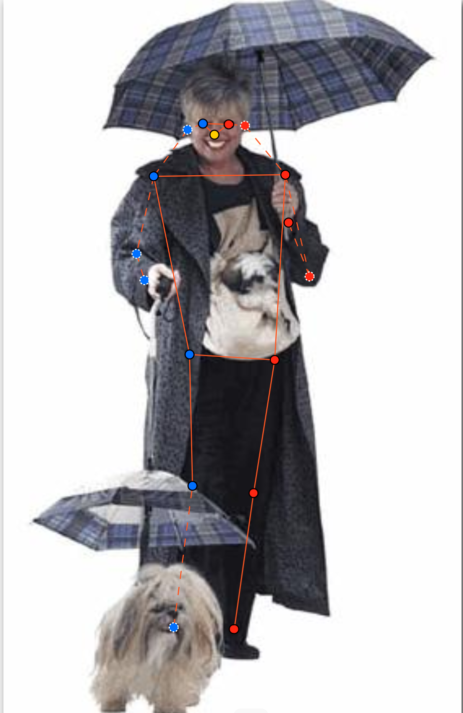
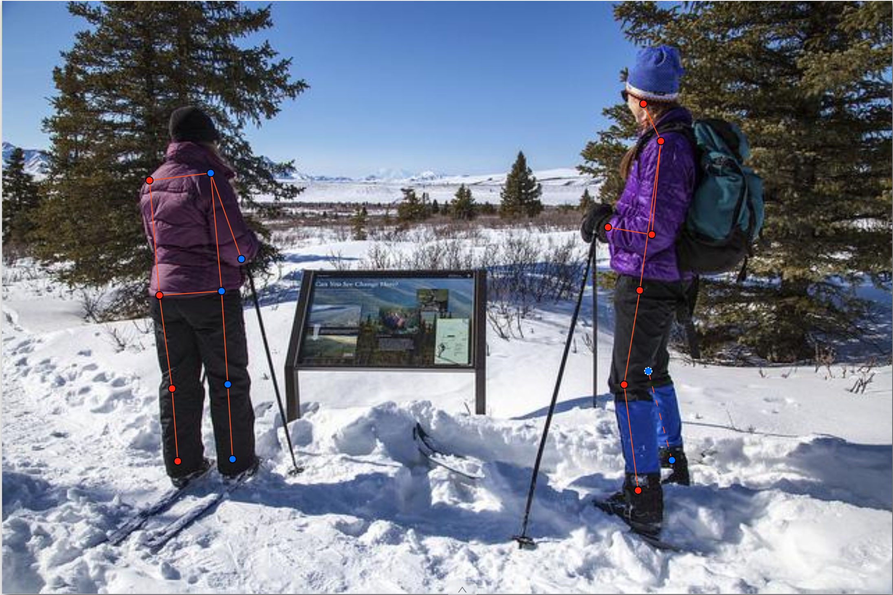
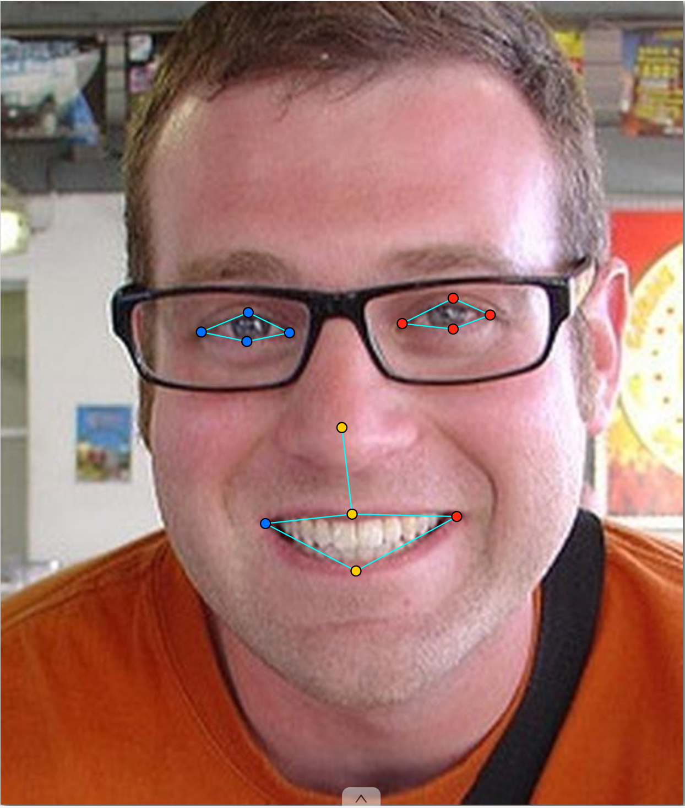
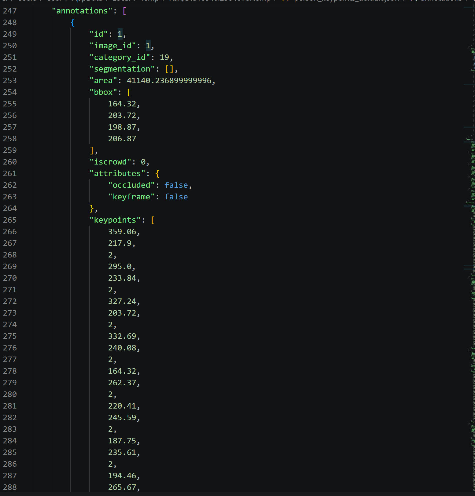

# Báo cáo cá nhân — HoVaTen-MSSV

Đổi tên file theo quy tắc `MSSV_HoTen.md`. Ví dụ: `20241234_NguyenVanAn.md`.

Dữ liệu: 12 ảnh người COCO val2017 (Lin et al., 2014) và 8 ảnh chân dung Wikimedia Commons, chỉ dùng trong lớp.

## 0. Thông tin học viên

- Họ tên: Vũ Việt Anh   
- MSSV: 2A202603214
- Email: vanhvuuu2006@gmail.com
- Link repository: https://github.com/vanhvuuu2006-bit/K5-L2A-Vu_Viet_Anh-03214-KeypointPose-Student
- Phiên bản CVAT (Help → About): 2.74.1
- Máy: hệ điều hành win 10 · RAM 16 GB · chạy CVAT chế độ đầy đủ 
- Bộ ảnh (`src/exports/assignment.json` do `lab.py setup` tạo): có / không
- Giờ bắt đầu: 16h40
- Giờ kết thúc: 19h00

## 1. Kiểm tra label (CP0)

| Label | Kiểu | Số điểm | Tên điểm đúng bảng của lab? | Đúng thứ tự? | Số cạnh |
|---|---|---:|---|---|---:|
| `person` | skeleton | 17 | đúng | đúng  | 19 |
| `face` | skeleton | 13 | đúng | đúng | 13 |

Mẫu `person` dựng theo người quay mặt về camera (các điểm `left_*` nằm bên phải khung mẫu)? Có / Không

Cách đổi cờ `occluded` / `outside` cho **một điểm** trên phiên bản CVAT này (một câu):
 nhấp chuột phải trực tiếp vào điểm đó trên ảnh (hoặc tìm tên điểm đó trong danh sách thành phần của đối tượng ở bảng thuộc tính bên phải) và chọn trạng thái tương ứng trong menu hiện ra
...

## 2. Số lượng đã gán và thời gian (CP1, CP2)

| Nhóm ảnh | Số ảnh | Số skeleton đã gán | Số người dưới 60 px (không gán) | Số poster / gương / màn hình bỏ qua | Thời gian (phút) |
|---|---:|---:|---:|---:|---:|
| `easy` | 5 | 5 | 5| 0 | 0 | 10p  
| `occluded` | 3 | 3 | 6 | 0 | 0 | 10p
| `back` | 2 | 2 | 4 | 0 | 0 | 10p
| `small` | 1 | 1 | 2 | 2 | 1 | 10p
| `crowd` | 1 | 1 | 3 | 0 | 0 | 10p
| `faces` | 8 | 8 | — | 0 | 0 | 15p

- Số ảnh người đã xong ở mốc phút 105:10/10
- Thời gian thực tế (phút): CP1 _50p__ · CP2 _15p__ · CP3 ___
- Ảnh tốn thời gian nhất là ảnh nào, vì sao?

...

## 3. Bảng ca khó (CP1, CP2)

Mỗi điểm bạn phân vân một dòng, nhất là phân vân giữa `v = 1` và `v = 0`, hoặc không chắc hướng người.

| Ảnh | Người / mặt | Điểm | Cờ đã chọn | Phân vân giữa | Lý do chọn |
|---|---|---|---:|---|---|
| face_294580.jpg | mặt | 13 |  | phần mặt đeo kính dâm phân vân phần mắt giữa v=0 và v=1 | chọn v=1, ước chừng theo cách nhìn (đã hỏi lab coach) |
| 000000167027.jpg | người | 17 | | có 2 người ngồi ở góc phải, có nên gán skeleton hay không | chọn không vì pixel nhỏ |
| | | | | | |

## 4. Bảng tự review (CP3)

Đi từ ảnh cuối về ảnh đầu. 5 ảnh người (ít nhất 2 ảnh `back` hoặc `crowd`) và 3 ảnh mặt. Ít nhất 8 dòng, kể cả dòng `ok`. Ghi lỗi trước, sửa sau.

Mã lỗi dùng đúng một trong: `lr_swap`, `vis_flag`, `position`, `missing`, `extra`, `ok`.

| Ảnh | Người / mặt | Điểm | Mã lỗi | Ghi chú | Đã sửa? |
|---|---|---|---|---|---|
| 000000167027.jpg | người | | extra | 2 người ngồi ở bên phải | đã sửa |
| 000000240340.jpg | người | | ok | | |
| 000000391222.jpg | người | | ok | | |
| 000000463932.jpg | người | | ok | | |
| 000000493741.jpg | người | | ok | | |
|face_159828.jpg |mặt | |ok |  | |
| face_294580.jpg | mặt |  | vis_flag |người đeo kính râm không thể xác định vị trí mắt | đã sửa |
| face_92028.jpg | mặt | | ok | | |

Tổng hợp số lỗi theo mã:

| `lr_swap` | `vis_flag` | `position` | `missing` | `extra` | `ok` |
|---:|---:|---:|---:|---:|---:|
| 0 | 1 | 0 | 0 | 1 | 6 |

Điểm còn phân vân giữa `v = 1` và `v = 0` (ghi cả hai lựa chọn và lý do chọn):
đeo kính râm không xác định được vị trí => gán v=0
Ước lượng vị trí nếu mở mắt => gán v=1 ( đã hỏi lap coach)
...

## 5. Kiểm file xuất và kết quả tự kiểm (CP4)

Tự kiểm tay trong file JSON:

| File | Người / mặt kiểm (ảnh, thứ tự) | Số phần tử `keypoints` | Điểm `outside` ra `v = 0`, `occluded` ra `v = 1`? | `num_keypoints` khớp? |
|---|---|---:|---|---|
| `VuVietAnh_persons.zip` | 000000056651.jpg, #1 | 51 | Đúng | Khớp (16) |
| `VuVietAnh_persons.zip` | 000000184224.jpg, #1 | 51 | Đúng | khớp(17) |
| `VuVietAnh_faces.zip` | face_317330.jpg, #1 | 39 | Đúng | khớp |

Sau khi xuất, CVAT ghi `occluded` thành `v = _1__` và `outside` thành `v = _0__`. Tọa độ của điểm `outside` trong file là `0, 0` hay tọa độ cũ? toạ độ cũ

Hai job đã chuyển sang completed trên CVAT? Có / Không
Có

Dán phần **TÓM TẮT** in ra từ `src/check_submission.py`:

File person: VuVietAnh_persons.zip
  Số ảnh: 12 · số skeleton `person`: 20 · mỗi annotation 51 số
  Skeleton theo ảnh: 000000056651=2, 000000091637=2, 000000167027=2, 000000184224=1, 000000189365=2, 000000240340=1, 000000261732=1, 000000381889=3, 000000391222=2, 000000461002=2, 000000463932=1, 000000493741=1
  Cờ v: v=2 209 (61%) · v=1 43 (13%) · v=0 88 (26%)
  num_keypoints trung bình: 12.6
- File face: VuVietAnh_faces.zip
  Số ảnh: 8 · số skeleton `face`: 8 · mỗi annotation 39 số
  Skeleton theo ảnh: face_105668=1, face_159828=1, face_178208=1, face_294580=1, face_421231=1, face_425647=1, face_53580=1, face_92028=1
  Cờ v: v=2 102 (98%) · v=1 2 (2%) · v=0 0 (0%)
  num_keypoints trung bình: 13.0
- Ghi chú: 88 điểm v = 0 vẫn mang tọa độ cũ (CVAT 2.x xuất như vậy; chuẩn COCO ghi 0, 0). Không phải lỗi: điểm v = 0 bị bỏ qua khi huấn luyện và khi chấm.
- Số [LỖI]: 0 · số [CẢNH BÁO]: 4
Kết quả: ĐẠT (đọc lại từng cảnh báo ở trên)

Các `[CẢNH BÁO]` còn giữ nguyên và lý do: 

[CẢNH BÁO] 000000056651.jpg #1: cặp wrist nằm ngược phía so với các cặp còn lại. Có thể đổi trái/phải một cặp (`lr_swap`), hoặc tay / chân bắt chéo thật: kiểm lại.
[CẢNH BÁO] 000000461002.jpg #1: cặp knee, ankle nằm ngược phía so với các cặp còn lại. Có thể đổi trái/phải một cặp (`lr_swap`), hoặc tay / chân bắt chéo thật: kiểm lại.
Vẫn giữ nguyên vì bắt chéo thật
## 6. Ảnh chụp màn hình

1. Label `person` trong label constructor (đủ 17 điểm có tên):

   

2. Một người quay lưng đã gán, cờ đã đặt:

   

3. Một khuôn mặt đã gán 13 điểm, phóng to vùng mắt:

   

4. Một đoạn JSON xuất của một người:

   
   [JSON export](images/4_json_export2.png)

Nguồn ảnh: COCO val2017 / Wikimedia Commons.

## 7. Tự đánh giá

1. Lỗi bạn mắc nhiều nhất hôm nay, và cách bạn sẽ tránh ở dự án thật:

   vẫn nhầm về hướng trái phải của ảnh, khá bối rối khi các ảnh có người quay lưng, các bộ phận cơ thể chèn lên nhau

2. Một quy tắc bạn đề xuất thêm vào guideline (kèm ảnh ví dụ nếu có):
   với các ảnh vẽ faces, khi ảnh người có đeo kính râm khó xác định các vị trí của mắt(hoặc nhắm mắt) nên đề outside tránh làm nhiễu dữ liệu huấn luyện
   

3. Nhãn của bạn đi vào model ở đâu? Chọn một lỗi bạn đã sửa và nói nó sẽ làm model học sai thế nào (heatmap, trọng số trong loss, hay bước lật ảnh):
• Tọa độ \((x, y)\): Được chuyển đổi từ tọa độ điểm sang bản đồ nhiệt (Ground-truth Heatmap) — là một ảnh nhỏ có phân phối chuẩn Gaussian 2D đặt tâm tại đúng vị trí khớp. Mô hình sẽ học cách dự đoán ra các bản đồ nhiệt này.
• Cờ hiển thị (\(v\)): Được dùng làm mặt nạ trọng số (Loss Weight / Mask) trong hàm mất mát (Loss function). Các điểm có \(v = 0\) (outside) sẽ bị gán trọng số bằng 0 để mô hình bỏ qua, không tính lỗi và không ép mô hình phải đoán mù các khớp nằm ngoài khung hình
- Gắn nhầm điểm bên trái sang bên phải (lr_swap) làm phá vỡ tính đối xứng giải phẫu học tự nhiên của cơ thể người mà mô hình đang cố gắng học

## 8. Khó khăn và lỗi kỹ thuật

Vẫn bị nhầm trái phải khi người quay lưng, khoanh tay khoanh chân

## Bonus (nếu làm)

### B1 — 3 ảnh người khó thêm

| Ảnh | Số skeleton | Số người dưới 60 px | Ca khó nhất |
|---|---:|---:|---|
| 000000005294.jpg | 3 | 0 | người ngồi cuối cùng từ phải sang trái |
| 000000125998.jpg | 3 | 0 | đều chỉ còn từ đầu gối trở xuống |
| 000000465765.jpg | 3 | 0 | người đứng cuối cùng khá mờ khó nhận diện khuôn mặt |

Kết quả `src/check_submission.py` cho `HoVaTen_bonus_persons.zip`:

File person: VuVietAnh_bonus_persons.zip
  Số ảnh: 3 · số skeleton `person`: 9 · mỗi annotation 51 số
  Skeleton theo ảnh: 000000005294=3, 000000125998=3, 000000465765=3
  Cờ v: v=2 63 (41%) · v=1 17 (11%) · v=0 73 (48%)
  num_keypoints trung bình: 8.9
- File face: VuVietAnh_bonus_faces.zip
  Số ảnh: 5 · số skeleton `face`: 5 · mỗi annotation 39 số
  Skeleton theo ảnh: face_317330=1, face_379585=1, face_45276=1, face_507166=1, face_68290=1
  Cờ v: v=2 60 (92%) · v=1 5 (8%) · v=0 0 (0%)
  num_keypoints trung bình: 13.0
- Ghi chú: 73 điểm v = 0 vẫn mang tọa độ cũ (CVAT 2.x xuất như vậy; chuẩn COCO ghi 0, 0). Không phải lỗi: điểm v = 0 bị bỏ qua khi huấn luyện và khi chấm.
- Số [LỖI]: 0 · số [CẢNH BÁO]: 0
Kết quả: ĐẠT

### B2 — 5 ảnh khuôn mặt đen trắng / hồng ngoại

Ảnh không màu khó hơn ở điểm nào? Kính râm trên ảnh hồng ngoại có còn là `v = 1` không?
Trên ảnh màu thông thường, các chi tiết khuôn mặt rất dễ phân biệt nhờ sự khác biệt về sắc độ (như màu hồng đỏ của viền môi trên/dưới so với màu da, hay lòng trắng/tròng đen của mắt so với vùng da mí mắt). Khi chuyển sang ảnh không màu (grayscale), mọi chi tiết đều quy về các sắc độ xám gần giống nhau, khiến đường biên giữa môi và da, hoặc khóe mắt rất dễ bị hòa lẫn vào vùng bóng đổ
Ở các góc chụp nghiêng hoặc thiếu sáng, vùng hốc mắt, gầm mũi và khóe miệng trên ảnh không màu thường bị bết thành một mảng đen đồng nhất. Người dán nhãn rất dễ đặt lệch điểm keypoint do không nhìn rõ ranh giới giải phẫu thực tế.
- Tùy thuộc vào bước sóng hồng ngoại của camera (có thể là v = 2 hoặc vẫn là v = 1)
• Trường hợp chuyển thành v = 2 (Visible - Hiển thị rõ): Hầu hết các loại tròng kính râm thông thường chỉ được phủ lớp lọc tia cực tím (UV) và ánh sáng khả kiến, nhưng lại cho phép tia hồng ngoại gần (Near-Infrared - NIR) đi xuyên qua. Do đó, trên ảnh chụp từ camera hồng ngoại, tròng kính râm thường trở nên trong suốt, làm lộ rõ toàn bộ đôi mắt phía sau. Lúc này, các điểm mốc ở mắt nhìn thấy rõ ràng nên phải gắn là v = 2.
• Trường hợp giữ nguyên v = 1 (Occluded - Bị che khuất): Nếu chiếc kính râm đó được tráng gương dày, làm từ chất liệu đặc biệt chặn được cả tia hồng ngoại, hoặc camera hoạt động ở dải hồng ngoại nhiệt bước sóng dài (Thermal IR - nơi thủy tinh và nhựa chặn hoàn toàn bức xạ nhiệt), tròng kính vẫn hiện lên như một mảng tối đặc quánh che khuất đôi mắt. Khi đó, các điểm mốc ở mắt vẫn bị che khuất và giữ nguyên là v = 1
...

### B3 — Model so với nhãn của tôi (không tính điểm)

- Demo đã dùng: không dùng model
- Ảnh đã thử:

1. Model có trả điểm cho khớp bị che, hay khớp ngoài ảnh không? Confidence ở các điểm đó thế nào?

   ...

2. Với người quay lưng, model có đổi trái/phải không?

   ...

3. Bộ điểm của model có giống 17 điểm COCO không?

   ...

## 9. Tài liệu tham khảo và công cụ AI đã dùng

...
